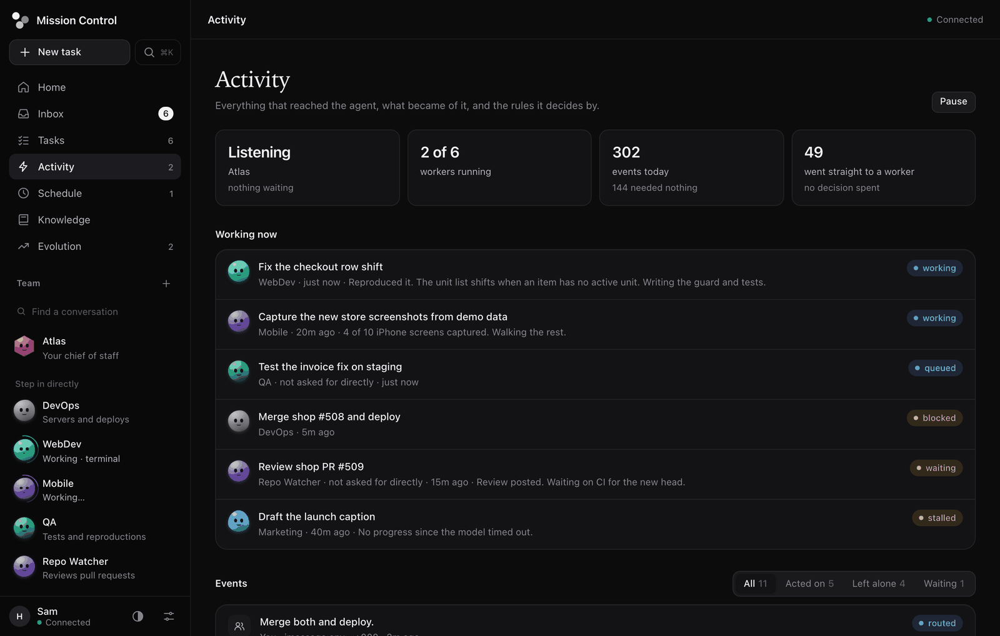
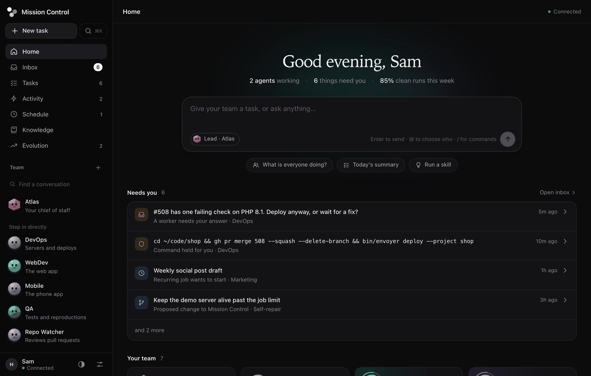

# Mission Control

[](https://github.com/hicka/missioncontrol/actions/workflows/test.yml)
[](LICENSE)

One AI agent that works for you, running on your own machine.

You talk to one agent, from the app, your phone or a chat channel. It answers what
it knows and hands the rest to workers with real tools on your computer: a terminal,
a browser, your files. You can see what each one is doing, and anything risky waits
for your approval. Use a local model with no key at all, or any API key you already
have. There is no account, no server to host, and no telemetry.



> [!WARNING]
> Agents run as your user, with your files and the keys you give them. The approval
> rules are defence in depth, **not a sandbox**. Read [SECURITY.md](SECURITY.md)
> before you connect it to anything you do not control.

## Quick start

You need Python 3.12 or newer.

```bash
git clone https://github.com/hicka/missioncontrol
cd missioncontrol
python3 -m venv venv && ./venv/bin/pip install -r requirements.txt
./venv/bin/playwright install chromium
./venv/bin/python server/main.py
```

Open <http://127.0.0.1:8899> and pick a model on the first screen. If Ollama or LM
Studio is already running, it is found for you. Otherwise choose a provider and paste
a key. Then start talking.

Your first run seeds a starter roster (a chief of staff, a researcher, an operations
manager and an engineer) that you can rewrite freely. Everything else is optional and
lives in Settings. Keys go in `.env` and settings in `settings.yaml`, both gitignored.

The server stays on `127.0.0.1` until you turn on remote access in Settings, which
also creates an API token. `MISSIONCONTROL_HOST` and `MISSIONCONTROL_PORT` override
the address and port.

## What it does

- **One agent, many hands.** A long-lived Router reads everything and does all the
  talking, with one memory across every channel. It answers directly or starts a
  worker: one isolated session per task, running as a profile with its own prompt,
  folder, model and tools. Several run at once, and slow commands move to the
  background so nothing waits on them.
- **Mostly quiet.** GitHub, webhooks, schedules and your other machines all arrive as
  events. Code filters most of them, an event on something a worker follows goes
  straight to that worker, and the Router judges the rest against rules you write in
  plain words.
- **You stay in charge.** Commands the guard holds wait in your Inbox, shown in full,
  and approving one runs exactly what you read. Recurring jobs do not start until you
  approve them. You can read any worker's steps, step in, stop it or restart it, and
  pause everything.
- **Keeps itself running.** A watchdog checks that each session is really getting
  somewhere, and restarts or nudges what is not. Sessions are stored durably, so a
  restart picks up where it stopped, and an interrupted worker checks the real state
  before repeating anything.
- **Any model.** Ollama, LM Studio, Anthropic, OpenAI, MiniMax, DeepSeek, or any
  OpenAI- or Anthropic-compatible endpoint. Each profile can use its own model, so a
  cheap one can triage while a strong one writes code. Usage is broken down per
  profile, and a daily budget caps the spend.
- **Real tools.** A terminal, a real Chromium browser whose logins persist and whose
  passwords stay in your OS vault, research with citations, your Mac's Notes, Calendar,
  Reminders, Mail and Messages (each off until you connect it, and it can never send
  mail), MCP servers, and Claude Code when a task needs software written.
- **Builds its own add-ons.** Ask for anything that should keep going on its own or
  sit on your desktop, and an agent writes a [module](docs/modules.md) for it: tools,
  timers and live cards drawn natively on your Mac's desktop. Each runs in its own
  sandboxed process with only the network, keys and files it was given.
- **Learns from mistakes.** Skills are procedures it saves and reuses. Your corrections
  and its own repeated failures become lessons, which start on trial and are kept only
  if the mistake stops happening. A lesson is only text in a prompt: it cannot grant a
  tool, lift a limit or approve a command.
- **Can improve itself, if you let it.** Off by default. An agent writes the change on
  its own branch, you see the diff once the tests pass, and a watchdog rolls it back if
  the app does not come back up. The files that hold its limits are off limits to it.

## The workspace



| Page | What it is for |
| --- | --- |
| **Home** | Hand over a task and see what needs you and what is in progress |
| **Inbox** | Everything waiting on you: held commands, questions, jobs, modules, proposed changes, sign-ins, lessons |
| **Tasks** | Every objective, who is on it and where it stands |
| **Activity** | What reached the agent, what became of it, its rules, and the watchdog |
| **Schedule** | Recurring jobs, and watches following something in flight |
| **Knowledge** | Shared memory, saved skills and website playbooks |
| **Evolution** | The share of clean runs over time, and the lessons behind it |
| **Modules** | Add-ons the agents built: their cards, tools, permissions, code and log |

The top chat is the agent. Writing to a profile by name below it is a direct line,
with no Router in between, which is how you step in. Press **Cmd+K** or **Ctrl+K** to
jump anywhere. Screenshots use sample data.

## How it works

```
 iMessage  Telegram  WhatsApp  email  app      GitHub  webhooks  cron  watches  other machines
     \        |         |       |     /            \       |       |      |        /
      the owner, always explicit                    admission: explicit | candidate | ignore
                \                                               /
                 `-----------> record it, then route it <------'
                                  |               |
                 nobody follows   |               |  a worker follows this thread:
                                  v               v  straight through, no decision spent
                           +-------------+     +---------+ +---------+
                           |   Router    |---->| Worker  | | Worker  |  one session per task
                           |  no shell   |<----|  tools  | |  tools  |  slow tools run as jobs
                           +-------------+     +---------+ +---------+
                            the only voice      report, never speak
```

Authority is settled in code from who sent an event, never from what a model concludes
about it. Work that came from an outside event cannot push, deploy or reach the network
without your approval, and runs without your keys.

[The kernel design](docs/super-agent.md) covers how an event moves, how a task ends,
authority, and what those rules do not cover. The ideas come from
[Exploring Super-agent Design](https://x.com/deepseekharness/status/2116857257245987236)
by DeepSeek Harness. This is an independent Python implementation.

## Channels and integrations

All of these are optional and set up in Settings.

| | What it does | What it needs |
| --- | --- | --- |
| **Telegram** | Talk to the agent | A bot token from @BotFather |
| **iMessage** | Talk to the agent | A [BlueBubbles](https://bluebubbles.app) server on a Mac |
| **WhatsApp Business** | Talk to the agent | The Meta Cloud API and a stable public webhook URL |
| **Email** | Talk to the agent | A dedicated mailbox |
| **Your WhatsApp** | Read your chats and files, [read-only](docs/whatsapp.md) | Node 20+, linked as a device. Not officially supported by WhatsApp |
| **GitHub** | Stream PRs, issues and CI failures to agents | The `gh` CLI signed in, and `cloudflared` |
| **Claude Code** | Delegate writing code, then review the diff | The [Claude Code](https://claude.com/claude-code) CLI |
| **[MCP servers](docs/mcp.md)** | Use another server's tools | An `mcpServers` block |
| **Webhooks** | Give any service a URL that reaches the agent | A route in Settings, and a tunnel for services outside your network |
| **Voice** | Spoken replies and transcribed voice notes | [Local neural speech setup](docs/local-voice.md), or a voice provider key |

## Commands

These work in the app and on messaging channels. Most answer without a model call.

| Command | Result |
| --- | --- |
| `/mission [@agent] objective` | Start a tracked task |
| `/skill slug {"input": "value"}` | Run a skill with validated inputs ([guide](docs/skill-harness.md)) |
| `/status`, `/tasks`, `/events`, `/agents` | See what is going on |
| `/policy [add text\|on id\|off id\|source name explicit\|candidate\|ignore]` | What it acts on unprompted |
| `/watchdog question` | Ask why something happened |
| `/stop [@agent\|all]`, `/resume mission-id` | Stop work, or resume a task |
| `/pause`, `/unpause` | Stop picking up work without stopping the app |
| `/remember fact`, `/recall search terms` | Save and find shared knowledge |
| `/watches`, `/watch cancel id` | See or stop background watches |
| `/model [provider] model`, `/effort level` | Pick a model and how hard it thinks |

## Other ways to run it

**Desktop apps.** The macOS app is fully native, with an always-on floating bar for
talking to the agent and seeing what it is doing (`⌥Space`). Once signed releases are
published it will keep itself up to date from them. Its data stays in your user profile. Build it with
`./venv/bin/python scripts/build_macos.py`, or see the
[native macOS guide](docs/native-macos.md). The newest unsigned macOS and Windows builds
of master are always at [Latest build](https://github.com/hicka/missioncontrol/releases/tag/latest-build),
from the [build workflow](.github/workflows/build.yml).

**Docker.** See the [`Dockerfile`](Dockerfile) and
[`docker-compose.example.yml`](docker-compose.example.yml). Set your own `MC_API_TOKEN`.
The browser is left out unless you build with `--build-arg WITH_BROWSER=1`.

**Terminal.** `bin/mc` is a chat client that talks to the running server, with the same
agents, history and commands as the app. For a server on another machine, set `MC_URL`
and `MC_TOKEN`.

```
bin/mc                      chat with the lead agent
bin/mc -a engineer          chat with a profile directly
bin/mc "summarise today"    send one message, print the reply, exit
```

**Several machines.** Fleet mode shares memory, skills and playbooks between
installations, and the Router can hand a task to `agent@machine`. To connect two, create
a join code on one under Settings > Integrations and paste it into the other. Keep the
fleet port (8902) on a LAN or Tailscale, never on the open internet.

**Phone.** [Mission Control Mobile](https://github.com/hicka/missioncontrol-mobile) is a
companion iOS app that connects to the server with a URL and a token. There is no public
build yet, so you build and sign your own.

## Project layout

| Path | What it holds |
| --- | --- |
| `server/` | The FastAPI backend: kernel, model layer, channels, scheduler and tools |
| `server/router.py`, `workers.py`, `triggers.py`, `watchdog.py` | The heart of the kernel ([design](docs/super-agent.md)) |
| `server/modules.py`, `module_host.py`, `module_ui.py` | Modules: agent-built add-ons and their sandbox ([design](docs/modules.md)) |
| `web/` | The workspace UI for browsers and remote access, with no build step |
| `native/macos/`, `packaging/` | The native macOS app and installers |
| `bin/` | `mc`, the outside watchdog, and small CLIs for Envoyer, Forge and Meta |
| `bundled_skills/` | Starter procedures seeded into your skill library |
| `whatsapp/`, `laya/` | Optional Node services: a WhatsApp bridge and a local decision model |
| `tests/` | The test suite |
| `agents.example.yaml`, `settings.example.yaml`, `.env.example` | Starting points for your own config |

## Status and contributing

This is young software, built for one person's daily use and changing quickly. It is
used every day on macOS. Windows builds and Docker are built in CI but see much less
real use, so expect rough edges there.

Issues and pull requests are welcome: see [CONTRIBUTING.md](CONTRIBUTING.md). Please
report security problems privately, as described in [SECURITY.md](SECURITY.md).

## License

[MIT](LICENSE)
